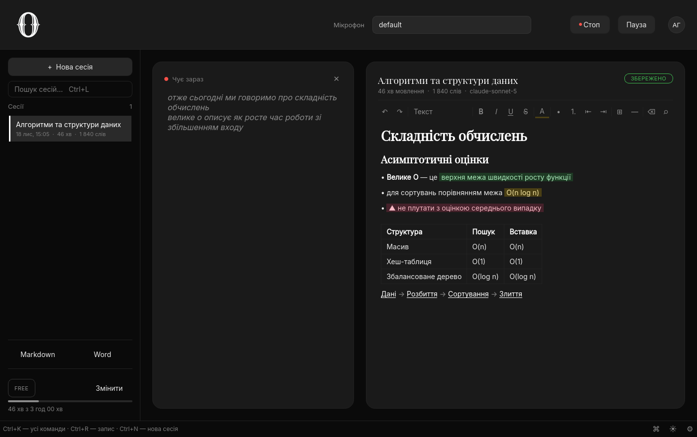

<div align="center">

<picture>
  <source media="(prefers-color-scheme: dark)" srcset="assets/logo_white.png">
  
</picture>

# OmniScribe

### Notes that take shape during the lecture, not after it

[](README.md)
[](README.en.md)


[**Download**](../../releases) · [Features](#features) · [Pricing](#pricing) · [Privacy](#privacy)

</div>

<br>



<br>

## The problem

In a lecture a student has to choose: **listen and understand**, or **keep up with writing**. Rarely both, well.

Transcription tools like Otter.ai, Notta or Fireflies solve half of it — they faithfully capture what was said. But the output is either a wall of text, or a structured summary that arrives **after** the lecture is over. Nobody offers notes that grow while the lecturer is still speaking.

|  | Typical transcriber | OmniScribe |
|---|---|---|
| When structure appears | after the session | while speaking |
| What you get | verbatim text or a summary | notes with hierarchy, terms, tables |
| Student edits | afterwards, in a separate file | during the lecture, in the app itself |
| Where it is stored | in the vendor's cloud | locally, on the student's computer |

## How it works

The student puts the laptop on the desk, picks a microphone and presses **Record**. Then:

1. **Split on pauses.** The VAD cuts the stream where the lecturer actually paused, not every 15 seconds — so sentences never break mid-thought.
2. **Transcription.** Whisper large-v3 via Groq, primed with the tail of the previous fragment so terms and names stay consistent.
3. **Structuring.** Claude receives not just the new fragment but the list of sections written so far — and **appends to the right section** when the lecturer returns to an earlier topic, instead of starting over.
4. **Live notes.** Headings, key points, highlighted terms, tables and diagrams appear while the lecturer is still talking.

Transcription and structuring run in separate threads: while Claude writes up one fragment, Whisper is already decoding the next — nothing is lost in the queue.

## Features

**Notes**
- Three heading levels, nested lists, connected paragraphs
- Colour markers by meaning: <kbd>yellow</kbd> — exam-critical fact, <kbd>green</kbd> — definition, <kbd>pink</kbd> — the lecturer's caveat
- Tables when the lecturer compares several things across attributes
- Process diagrams when a sequence of steps is described

**Editor**
- Full formatting: character styles, paragraph styles, lists, indents, tables
- Five highlighters and three text colours
- Find in notes, undo, autosaved edits

**Workflow**
- Command palette <kbd>Ctrl</kbd>+<kbd>K</kbd> — every action from the keyboard
- Presets: detailed notes, key points only, exam preparation
- Export to Markdown and Word with formatting preserved
- Session history with search, duration and word count

**Appearance**
- Ukrainian and English, switched without a restart
- Dark and light themes, three base tones, density and text size

## Download

Ready-made builds are in [Releases](../../releases).

### Windows

Run `OmniScribe-Setup-x.y.z.exe`. SmartScreen will warn about an unknown publisher — the app is not code-signed yet: **More info → Run anyway**.

### macOS

Open `OmniScribe-x.y.z-macos.dmg`, drag the app to Applications. On first launch use **right-click → Open** (a normal double-click is blocked by Gatekeeper for unsigned apps). If it still refuses:

```bash
xattr -dr com.apple.quarantine /Applications/OmniScribe.app
```

### Linux

```bash
sudo dpkg -i OmniScribe-x.y.z-linux-amd64.deb
```

## First run

Two API keys are needed — both have a free tier that covers a few lectures:

| Key | Where to get it | What for |
|---|---|---|
| Groq | [console.groq.com/keys](https://console.groq.com/keys) | speech recognition |
| Anthropic | [console.anthropic.com](https://console.anthropic.com/settings/keys) | turning speech into notes |

Paste them into **⚙ Settings → Models**. Keys are stored in `~/.omniscribe/.env` and never leave the computer.

## Pricing

| | Free | Pro | Team |
|---|---|---|---|
| | **₴0** | **₴199/mo** | **₴499/mo** |
| Recording | 3 h/mo | 30 h/mo | unlimited |
| Note model | Haiku 4.5 | Sonnet 5 | Opus 5 |
| Tables and diagrams | — | ✓ | ✓ |
| Note presets | — | ✓ | ✓ |
| Word export | — | ✓ | ✓ |
| Shared sessions, API | — | — | ✓ |

> Payment is in demo mode for now: the form accepts a test card only and no money is charged.

## Privacy

Notes never leave the computer — they live in a local database at `~/.omniscribe/notes.db`. The app has no server of its own and uploads nothing.

Exactly two kinds of data go out, and only while recording:

- audio fragments → **Groq** (transcription)
- transcribed text → **Anthropic** (formatting)

The account is local too: the password is stored as a salted PBKDF2-HMAC-SHA256 hash and never kept in plain text.

## Built with

Python 3.11+ · PySide6 (Qt 6) · sounddevice (PortAudio) · SQLite · Groq Whisper large-v3 · Anthropic Claude

Installers are built by GitHub Actions: `.deb` for Linux, an NSIS `.exe` for Windows, a `.dmg` for macOS — each on its own platform, since PyInstaller cannot cross-compile.

## Roadmap

- [ ] Note sync across devices
- [ ] Shared sessions: a group keeping one set of notes together
- [ ] A lecturer's glossary shared across a course
- [ ] Code-signed installers
- [ ] Several lecture languages within one session

## Licence

Proprietary software. © 2026 Artem Horkusha, Iliya Mosiichyk. All rights reserved.

The source is visible for review, but not licensed for use, copying or redistribution — see [LICENSE](LICENSE) for details.

Licensing enquiries: gorkusaartem700@gmail.com
