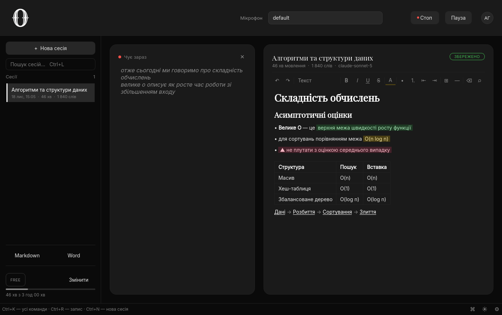

<div align="center">

<picture>
  <source media="(prefers-color-scheme: dark)" srcset="assets/logo_white.png">
  
</picture>

# OmniScribe

### Конспект народжується під час лекції, а не після неї

[](README.md)
[](README.en.md)


[**Завантажити**](../../releases) · [Можливості](#можливості) · [Тарифи](#тарифи) · [Приватність](#приватність)

</div>

<br>



<br>

## Проблема

Студент на парі змушений обирати: **слухати й розуміти** або **встигати записувати**. Рідко вдається і те, і те якісно.

Транскрайбери на кшталт Otter.ai, Notta чи Fireflies вирішують половину задачі — вони дослівно фіксують сказане. Але на виході або суцільна стіна тексту, або структурований підсумок, який приходить **після** того, як лекція закінчилась. Конспекту, який росте разом із мовленням лектора, не пропонує ніхто.

|  | Типовий транскрайбер | OmniScribe |
|---|---|---|
| Коли з'являється структура | після завершення | під час мовлення |
| Що на виході | дослівний текст або підсумок | конспект з ієрархією, термінами, таблицями |
| Правки студента | після, в окремому файлі | прямо під час лекції, в самому застосунку |
| Де зберігається | у хмарі сервісу | локально, на комп'ютері студента |

## Як це працює

Студент кладе ноутбук на парту, обирає мікрофон і натискає **Записати**. Далі:

1. **Нарізка по паузах.** VAD ріже потік там, де лектор справді зробив паузу, а не кожні 15 секунд — тому речення не розриваються посеред думки.
2. **Розпізнавання.** Whisper large-v3 через Groq, із підказкою з попереднього фрагмента, щоб терміни й імена лишались однаковими.
3. **Структурування.** Claude отримує не лише новий фрагмент, а й перелік уже написаних розділів — і **дописує в потрібний розділ**, коли лектор повертається до теми, замість починати конспект заново.
4. **Конспект наживо.** Заголовки, тези, виділені маркером терміни, таблиці й схеми з'являються у вікні, поки лектор ще говорить.

Розпізнавання й структурування працюють у різних потоках: поки Claude оформлює один фрагмент, Whisper уже розбирає наступний — мовлення не губиться в черзі.

## Можливості

**Конспект**
- Заголовки трьох рівнів, вкладені списки, зв'язні абзаци
- Кольорові маркери за змістом: <kbd>жовтий</kbd> — факт для іспиту, <kbd>зелений</kbd> — означення, <kbd>рожевий</kbd> — застереження лектора
- Таблиці, коли лектор порівнює кілька речей за ознаками
- Схеми процесів, коли описує послідовність етапів

**Редактор**
- Повноцінне форматування: накреслення, стилі абзаців, списки, відступи, таблиці
- П'ять маркерів і три кольори тексту
- Пошук по конспекту, скасування, автозбереження правок

**Робота**
- Командна палітра <kbd>Ctrl</kbd>+<kbd>K</kbd> — будь-яка дія з клавіатури
- Пресети: детальний конспект, стислі тези, підготовка до іспиту
- Експорт у Markdown і Word зі збереженням форматування
- Історія сесій з пошуком, тривалістю й кількістю слів

**Вигляд**
- Українська та англійська, перемикаються без перезапуску
- Темна й світла теми, три відтінки основи, щільність і кегль

## Завантаження

Готові збірки — у [Releases](../../releases).

### Windows

Запустити `OmniScribe-Setup-x.y.z.exe`. SmartScreen попередить про невідомого видавця — застосунок поки не підписаний сертифікатом: **Докладніше → Виконати в будь-якому разі**.

### macOS

Відкрити `OmniScribe-x.y.z-macos.dmg`, перетягнути в Applications. Перший запуск — **правий клік → Відкрити** (на звичайний подвійний клік Gatekeeper блокує непідписані застосунки). Якщо впирається:

```bash
xattr -dr com.apple.quarantine /Applications/OmniScribe.app
```

### Linux

```bash
sudo dpkg -i OmniScribe-x.y.z-linux-amd64.deb
```

## Перший запуск

Потрібні два ключі — обидва мають безкоштовний тариф, якого вистачає на кілька пар:

| Ключ | Де взяти | Навіщо |
|---|---|---|
| Groq | [console.groq.com/keys](https://console.groq.com/keys) | розпізнавання мовлення |
| Anthropic | [console.anthropic.com](https://console.anthropic.com/settings/keys) | оформлення конспекту |

Вставити у **⚙ Налаштування → Моделі**. Ключі зберігаються в `~/.omniscribe/.env` і не залишають комп'ютер.

## Тарифи

| | Free | Pro | Team |
|---|---|---|---|
| | **0 ₴** | **199 ₴/міс** | **499 ₴/міс** |
| Запис | 3 год/міс | 30 год/міс | без ліміту |
| Модель конспекту | Haiku 4.5 | Sonnet 5 | Opus 5 |
| Таблиці та схеми | — | ✓ | ✓ |
| Пресети конспектування | — | ✓ | ✓ |
| Експорт у Word | — | ✓ | ✓ |
| Спільні сесії, API | — | — | ✓ |

> Оплата поки в демо-режимі: форма приймає лише тестову картку, кошти не списуються.

## Приватність

Конспекти ніколи не залишають комп'ютер — вони лежать у локальній базі `~/.omniscribe/notes.db`. Застосунок не має власного сервера й нікуди їх не надсилає.

Назовні йде рівно два типи даних, і лише під час запису:

- фрагменти аудіо → **Groq** (розпізнавання)
- розпізнаний текст → **Anthropic** (оформлення)

Акаунт теж локальний: пароль зберігається як PBKDF2-HMAC-SHA256 хеш із сіллю, у відкритому вигляді не лежить ніде.

## Технології

Python 3.11+ · PySide6 (Qt 6) · sounddevice (PortAudio) · SQLite · Groq Whisper large-v3 · Anthropic Claude

Інсталятори збираються GitHub Actions: `.deb` для Linux, NSIS-`.exe` для Windows, `.dmg` для macOS — кожен на своїй системі, бо PyInstaller не вміє крос-компіляцію.

## Плани

- [ ] Синхронізація конспектів між пристроями
- [ ] Спільні сесії: група веде один конспект разом
- [ ] Словник термінів лектора, спільний для курсу
- [ ] Підпис інсталяторів сертифікатом
- [ ] Кілька мов лекції в одній сесії

## Ліцензія

Пропрієтарне програмне забезпечення. © 2026 Artem Horkusha, Iliya Mosiichyk. Усі права застережено.

Код відкритий для перегляду, але не для використання, копіювання чи розповсюдження — подробиці в [LICENSE](LICENSE).

Питання щодо ліцензування: gorkusaartem700@gmail.com
